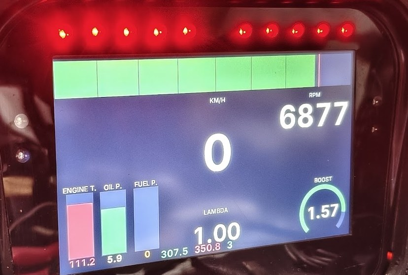

# OpenDashPro

Alternative firmware for the **DashPro** dashboard display, plus **OpenDashPro Studio**, a desktop app for designing your own screens and installing them on the dash over USB.

> **Experimental, unofficial software. Read [SAFETY.md](SAFETY.md) before using it in a vehicle.**
> Not affiliated with or endorsed by the maker of the DashPro.

## What it does
- **Your own layout:** numbers, bars, gauges, graphs and alerts on up to 3 pages, designed in Studio and installed over USB.
- **ECUs:** AiM CAN, FuelTech FTCAN 2.0, Megasquirt dash broadcast, and the Injepro S8000 native link (including its 14 analog inputs).
- **On the dash:** touch menus, shift light and alert LEDs, brightness, CAN monitor, touch calibration.
- **USB only:** installing uses the dash's own USB bootloader, which is never changed. The stock firmware can always go back on.

## Download
Get the latest version from **[Releases](../../releases)**:

| File | For |
|---|---|
| `OpenDashPro Studio-<version>-arm64.dmg` | Mac with Apple silicon |
| `OpenDashPro Studio-<version>.dmg` | Intel Mac |
| `OpenDashPro Studio Setup <version>.exe` | Windows (64-bit) |
| `OpenDashPro Studio-<version>.AppImage` | Linux (64-bit x86) |
| `opendashpro-<version>.hex` | The firmware on its own (Studio already includes it) |
| `SHA256SUMS.txt` | Checksums |

Then follow **[INSTALL.md](INSTALL.md)**.

## Licence
Free for personal, noncommercial use; no redistribution or modification. See [LICENSE](LICENSE) (PolyForm Strict 1.0.0 with an extra permission for your own dash). The source code is not published yet.
